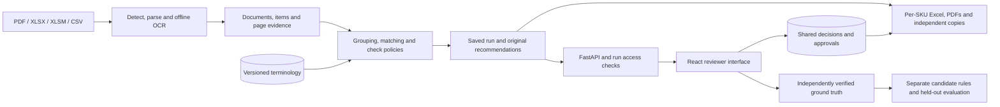

# Architecture

Kaizen is a Python comparison/review application with a React interface. It currently runs locally.
The Dockerfile and Render manifest prepare a future single-service deployment; GitHub CI does not deploy.

## Data flow

## Modules and boundaries

| Area | Responsibility |
| --- | --- |
| `ingest/` | Type detection, BOM tables, labels, drawings, PCOs, bundled offline OCR and evidence geometry. Word is unsupported. |
| `models/` | Typed documents/items, evidence, results, roles, discrepancies, thresholds and run metadata. |
| `matching/` | Normalization, approved relationships, fuzzy/typed component candidates, numeric guards and assignment. Optional semantic/AI adapters remain opt-in. |
| `checks/` | BOM–Label, BOM–Drawing, Label–Drawing, PCO–BOM, old/new labels and document coverage. |
| `terminology/` | Versioned scoped/item-anchored identity rules, import/export, snapshots and provenance. |
| `review/collaborative.py`, `access.py`, `sessions.py` | Current web decisions/approvals, account roles, ownership/grants, history and sessions. |
| `review/store.py` | Legacy two-reviewer CLI records and compatibility. The website does not select reviewer slots. |
| `review/learning.py`, `evaluation/learning.py` | Immutable training/evaluation partitions, independent verification, candidate jobs and frozen reports. |
| `reporting/` | Review-aware exports, per-SKU workbook layouts, safe decision imports, certificates and annotated BOMs. |
| `api/`, `cli/` | HTTP interface and local commands over the same pipeline/workspace. |
| `ui/src/` | Lazy-loaded routes, session-aware navigation, searchable lists, source previews and review forms. |

## Comparison safeguards

Normalization preserves original evidence. Matching first uses exact and approved scoped terminology,
then conservative fuzzy/component proposals with typed conflicts. Primary objects are distinguished from
holders, covers, packaging, labels and parts named after WITH. Explicit OR alternatives remain alternatives.
Missing attributes never establish equality; candidate scores are not calibrated probabilities.

One-to-one assignment handles ordinary identity rows. Approved assembly allocations have explicit
membership/quantity semantics; inferred live assembly proposals retain member evidence and require
review. Configuration/overlabel rows, uncertain package bases and drawing applicability are separate
questions. Drawings support text-callout presence/identity, not quantity or pictured-part placement.

`MISSING` is an engine code displayed as **Unmapped**, not a proven physical absence. Assemblies,
configurations, ambiguous alternatives and incompatible specifications are ineligible for learned synonyms.

## Reproducibility and review

Inputs retain SHA-256, parser/checker versions, thresholds, terminology snapshots and extraction evidence.
The engine/CLI derives identity from these inputs and extracted results. Browser uploads and independent
copies receive distinct run IDs, so repeated uploads are separate review records. Do not infer source
changes solely from a different web run ID. Run comparison suppresses unchanged relocated copies.

Original recommendations remain immutable. The web review store computes current progress/findings
from the shared decision and approval snapshot. Edits invalidate approvals; concurrent revisions require
refreshing. Confirmed findings remain visible after approval. Self-approval is recorded explicitly.
Ground-truth verification additionally requires a different administrator and applicable source evidence.

## Exports, storage and operation

Overview's Summary and Complete details XLSX downloads use one worksheet per SKU. Complete details
adds all comparisons and supporting audit sheets; both accept decision/comment round trips. The CLI and
portable bundles retain compatible workbook workflows. Imports validate run IDs, stable row IDs and
conflicts, merge reviewer changes separately from engine columns, and invalidate changed approvals.

The workspace contains SQLite, source copies, saved runs, imports and learning artifacts. Real sources,
credentials and generated outputs stay local/ignored; committed golden files are synthetic. SQLite
access is serialized in one process. The prepared Render setup uses one worker and a persistent disk;
multiple instances require a shared database/storage design. Back up the complete workspace consistently.

Optional external password authentication shares account verification only. Roles, sessions, reviews
and files stay in the Kaizen workspace. Optional external AI transmits configured suggestion inputs;
closed-testing candidate learning stays offline and never automatically replaces live results.

See [API](api-contract.md), [accounts/deployment](hosted-collaboration.md),
[learning](closed-testing.md), [test strategy](test-strategy.md) and [limitations](known-limitations.md).
